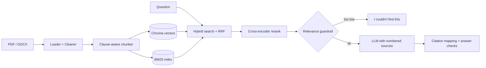

# Contract Analyzer: RAG with citations

Ask questions about contracts and get answers that cite the exact file, page and clause.

**Live demo:** <your Hugging Face Space link>

## Architecture



## Features
- Clause-aware chunking that keeps each clause together and records page and section
- Hybrid retrieval (vector + BM25, merged with Reciprocal Rank Fusion) plus reranking
- Citations on every answer, with invalid citations removed
- Guardrails: refuses weak retrievals without calling the LLM, and flags numbers not found in the sources
- Evaluation harness comparing four retrieval setups

## Results
Paste the tables from `evaluation/results/report.md` here (N questions on M contracts).

## Run locally
```bash
python -m venv venv && source venv/bin/activate   # Windows: venv\Scripts\Activate.ps1
pip install -r requirements.txt
cp .env.example .env                              # add your LLM key
python -m scripts.ingest_folder
python -m streamlit run app/main.py
```

## Evaluate
```bash
python -m evaluation.run_eval --retrieval-only
python -m evaluation.run_eval --sleep 6
```

## Limitations
- Scanned PDFs need OCR (not included)
- Information only, not legal advice